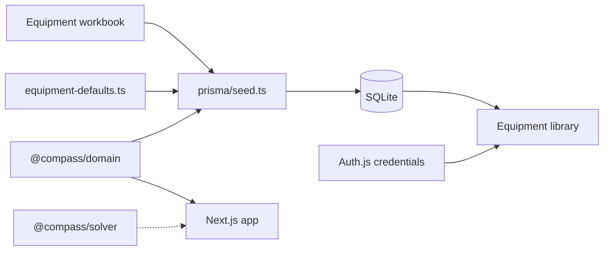

# Compass

Browser-based cargo load planning for sea containers, road trailers, air ULDs, and pallets.

Compass is a 3D load planner. A project walks four steps: **Data** (cargo), **Setup** (equipment), **Workspace** (unit table and 3D preview), **Load plan** (isometric 3D, axle loads, sequence). The solver lives in `packages/solver` and runs in a Web Worker.

## Setup

Node.js 20.9 or newer, and pnpm 10.

```bash
pnpm i && pnpm prisma migrate dev && pnpm db:seed && pnpm dev
```

Open [http://localhost:3000](http://localhost:3000).

Demo password for every local account: `compass-demo`

| Role | Email |
| --- | --- |
| Admin | admin@compass.local |
| Planner | planner@compass.local |
| Viewer | viewer@compass.local |

Copy `.env.example` to `.env` if you are not using the generated local env. `DATABASE_URL` is a SQLite file. `AUTH_SECRET` must be a long random string.

The workbook stays at the repository root. The seed reads sheets Sea, Air, Land, and Pallets.

## Scripts

| Command | What it does |
| --- | --- |
| `pnpm dev` | Next.js dev server |
| `pnpm db:seed` | Import the workbook and demo users |
| `pnpm test` | Vitest for planning defaults |
| `pnpm lint` | ESLint |
| `pnpm typecheck` | TypeScript |

## Architecture



- `src/` — App Router UI, auth, and the Prisma client
- `packages/domain` — shared zod types. Units are centimetres and kilograms
- `packages/solver` — pure TypeScript solver boundary. No UI imports. Algorithms start in a later phase
- `prisma/schema.prisma` — SQLite, shaped so the same models can move to Postgres
- `docs/ASSUMPTIONS.md` — payload, axle, and open-height defaults

Payloads and axle limits in the library are planning defaults. They are not certified equipment ratings.
